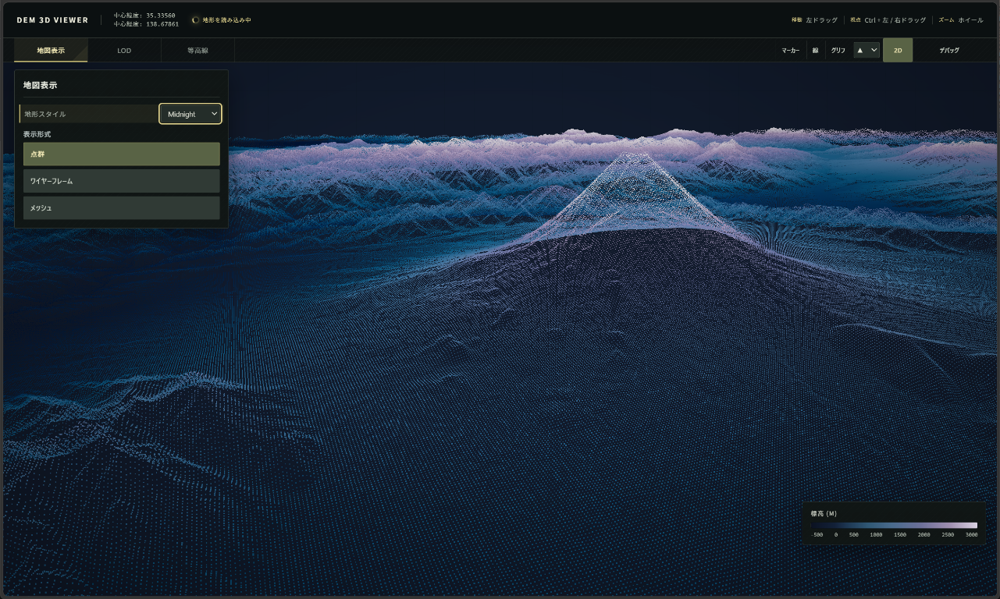
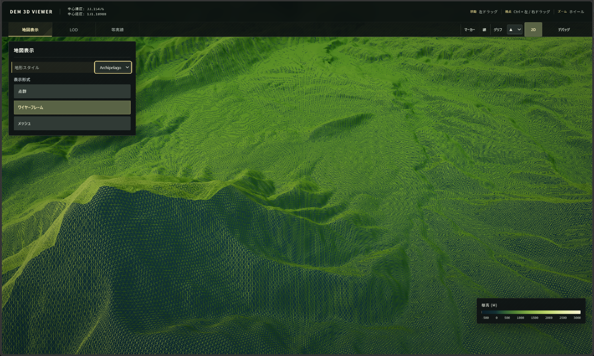
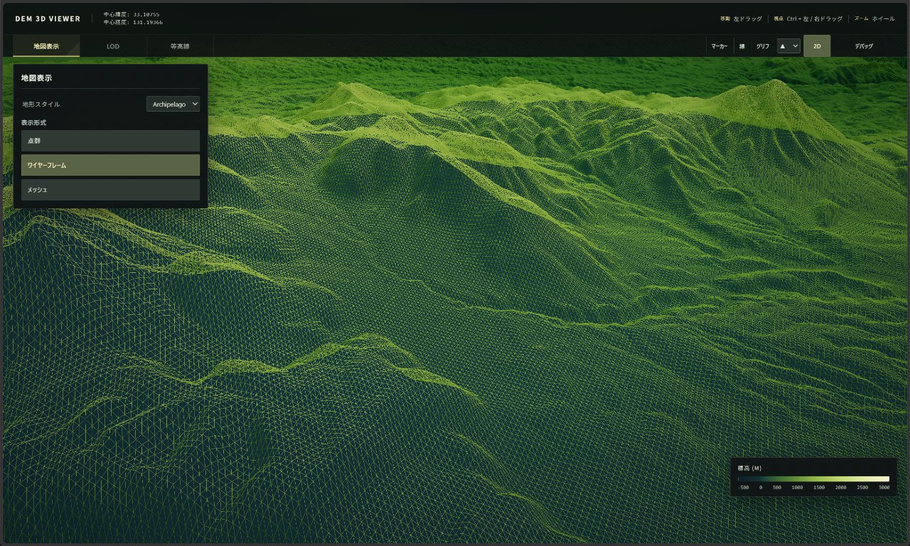
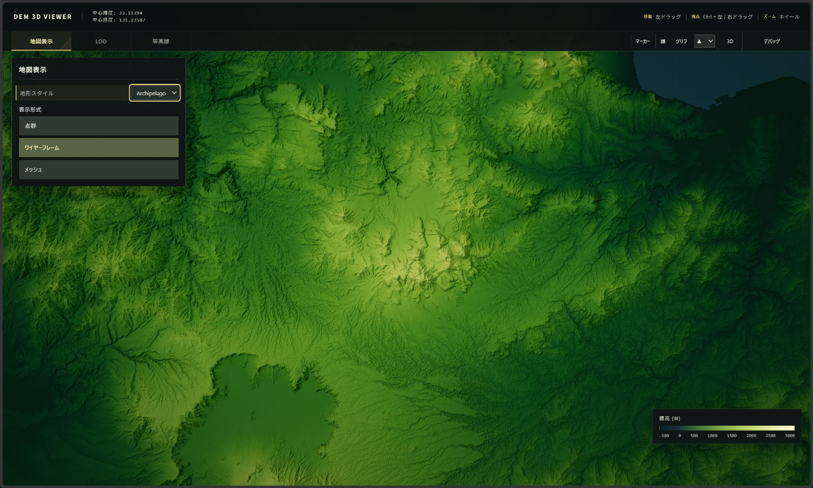
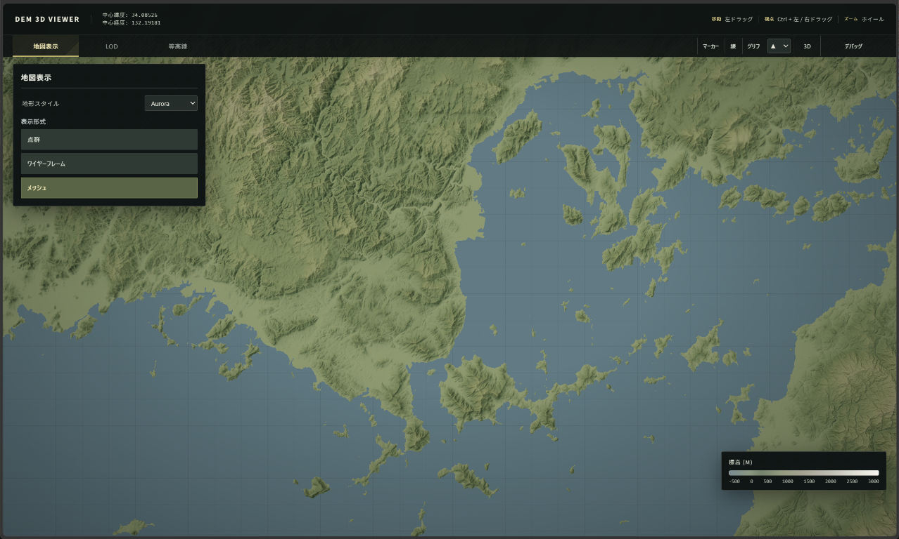
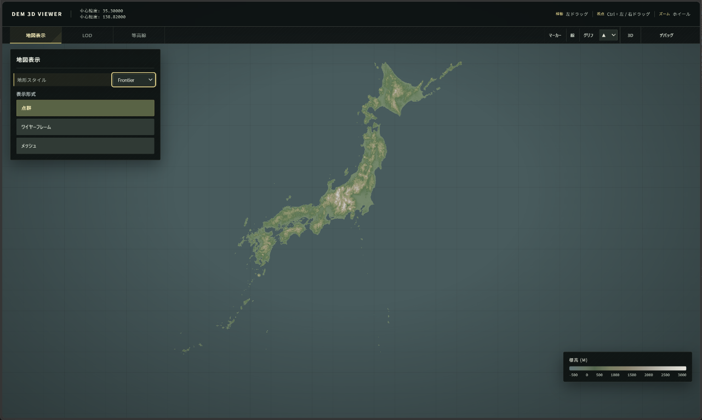
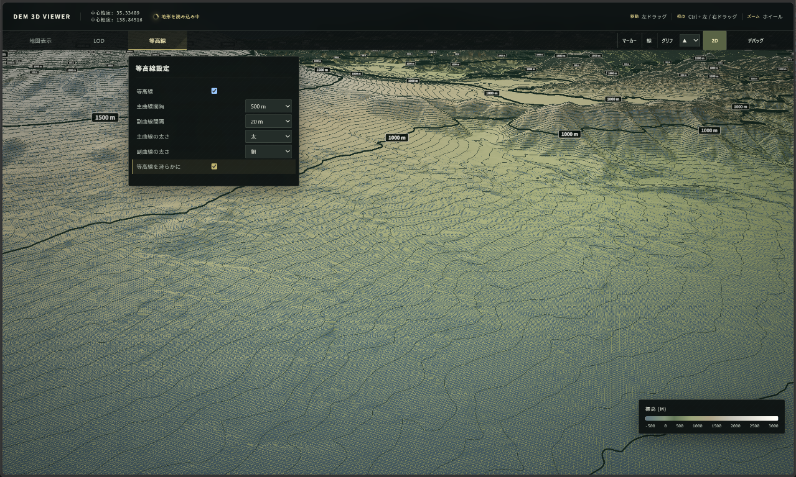

# DEM 3D Point Cloud Viewer

日本の標高タイルを表示するWebベースの3D地形ビューアです。

## 表示例

地形スタイル、表示形式、視点を切り替えた画面例です。

<table align="left" width="760">
  <colgroup>
    <col width="380">
    <col width="380">
  </colgroup>
  <tr>
    <td align="left"><br>Midnight・点群表示</td>
    <td align="left"><br>Archipelago・ワイヤーフレーム表示</td>
  </tr>
  <tr>
    <td align="left"><br>Archipelago・ワイヤーフレーム表示（別視点）</td>
    <td align="left"><br>Archipelago・3D表示</td>
  </tr>
  <tr>
    <td align="left"><br>Aurora・メッシュ表示</td>
    <td align="left"><br>Frontier・日本列島の表示</td>
  </tr>
  <tr>
    <td align="left"><br>等高線表示</td>
    <td></td>
  </tr>
</table>

## 起動方法

このフォルダーをカレントディレクトリにして、ローカルHTTPサーバーを起動します。

```powershell
python -m http.server 8000
```

ブラウザーで `http://localhost:8000/` を開いてください。ES modules のため、`index.html` を直接開くのではなくHTTPサーバー経由で起動します。

## 標高タイルデータ

標高タイルはサイズが大きいため、このリポジトリには含めていません。利用する場合はPNGタイルを `xyz/dem_merge/{z}/{x}_{y}.png` に配置してください。タイルデータの取得元・利用条件に従ってください。

### 地理院タイルのダウンロード

ルートの `get_map.py` は、国土地理院のXYZタイルを取得するスクリプトです。初期設定では `dem` のズームレベル9をダウンロードし、`xyz/dem/9/` に保存します。設定を変更する場合はスクリプト冒頭の `Z`、`LON`、`LAT`、`MESH_MODEL` を編集してください。

必要なPythonパッケージをインストールして実行します。

```powershell
python -m pip install numpy tqdm
python get_map.py
```

ダウンロードしたデータをビューアで使うには、`xyz/dem/9/` のタイルを `xyz/dem_merge/9/` に配置してください。大量のタイルを取得すると、保存容量とダウンロード時間が大きくなる場合があります。

## 依存ライブラリ

Three.jsの配布ファイルを `vendor/three/` に含めています。ライセンスは `vendor/three/LICENSE` を参照してください。
